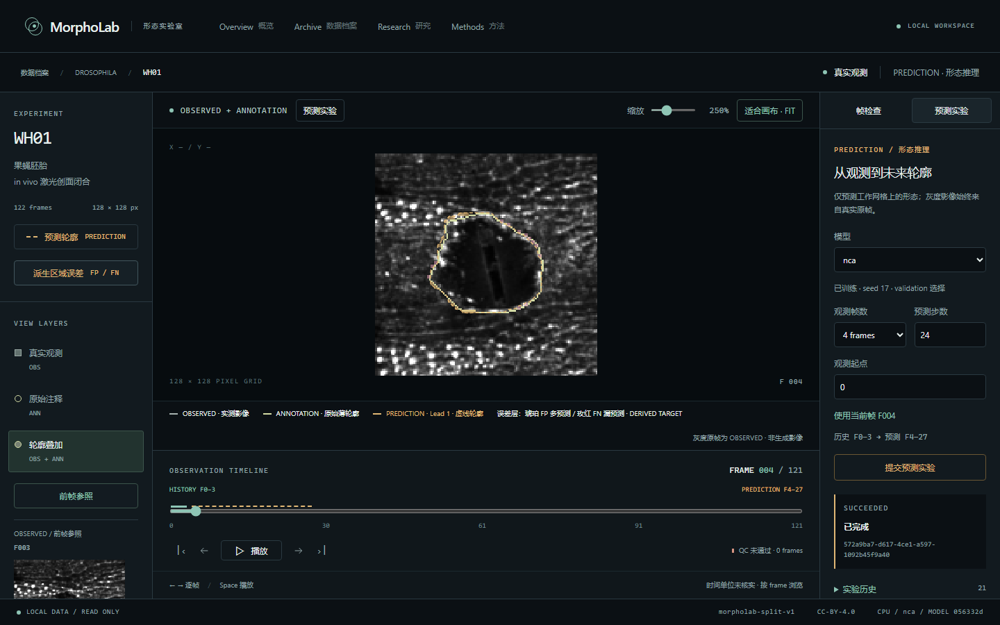
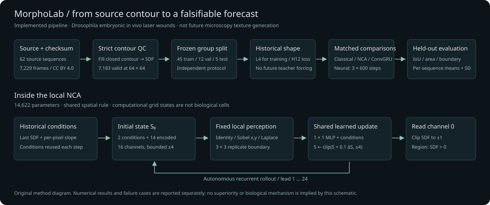
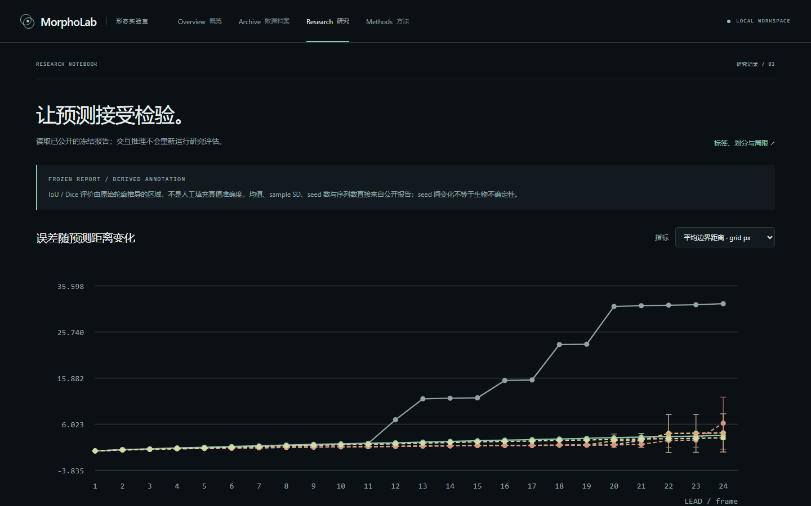

# MorphoLab · 形态实验室

[English](README.en.md) · [研究结果](docs/research/results.md) · [模型卡](docs/research/model-card.md) · [复现协议](docs/research/experiment-protocol.md)

研究真实显微时序中的创面闭合：给定历史轮廓，局部神经更新规则能否预测后续形态？

MorphoLab 是一个可在本机运行的科研工作台，也是一组可复算的对照实验。它连接真实数据审计、严格的派生标签管线、经典基线、自主实现的 NCA 与 ConvGRU，以及带来源和失败记录的预测作业。当前版本为 **0.1.0 研究原型**，数据、研究与工作台闭环已验证；版本和资产状态见 [GitHub Release](https://github.com/fzyz-whx/morpholab/releases/tag/v0.1.0)。



实际 Edge、1440×900，WH01 历史 F0–3 → 预测 F4–27。WH01 属于 train，此图展示软件流程，不是泛化证据。灰度始终是 **OBSERVED** 原帧；浅色线是发布者 **ANNOTATION**，琥珀虚线是 **PREDICTION**。未来显微纹理没有由网络生成。影像来自 Backová 等（2023），[Zenodo 7660424](https://doi.org/10.5281/zenodo.7660424)，CC BY 4.0；修改包括对比度映射、放大、派生目标及预测叠加。[完整署名](datasets/ATTRIBUTION.md)。

## 研究了什么

主域为 **果蝇胚胎 in vivo 激光创面闭合**，不是体外划痕或临床伤口。NCA 的网格单元是计算状态，不等同于真实细胞。输入是历史注释派生的形态，当前软件不自动分割原始显微图，也不支持治疗或生物干预因果结论。

我们比较 Persistence、恒法向速度、小型 ConvGRU、基础 NCA、更新幅度正则 NCA，以及单步监督消融。真实训练前冻结数据、模型和预算；test 不用于选权重、超参数或展示 seed。已有工作已经研究过本数据的视频预测和 NCA 伤口建模，本项目不把概念组合当作新颖性。



原创方法图，对应实际源码：固定局部感知、16 通道状态和共享更新网络；比较模型使用相同历史摘要。方法定义见[模型架构](docs/architecture/forecast-models.md)，预注册决策见 [ADR-0002](docs/project/decisions/ADR-0002-local-models-and-training-budget.md) 与 [ADR-0003](docs/project/decisions/ADR-0003-matched-window-horizon-ablation.md)。

## 得到了什么结果


本项目独立协议的 **5 条源序列代理、25 个共同窗口**，L4、未来 lead 1–24。先窗口→序列均值，再序列等权→每 seed 均值，最后对 seed17/29/43 求均值与样本标准差。阴影是训练 seed 的 SD，**不是生物学置信区间**；确定性方法没有 seed SD。目标是原始薄轮廓经严格 QC 派生的区域，不是原始人工填充 mask。

| 方法 | H24 IoU ↑ | H24 平均边界距离 ↓（64-grid px） |
|---|---:|---:|
| Persistence | 0.3368 | 3.624 |
| 恒法向速度 | 0.2691 | 31.782 |
| ConvGRU | 0.4128 ± 0.0446 | 6.242 |
| NCA | 0.4596 ± 0.0269 | 4.152 |
| 正则 NCA | 0.4612 ± 0.0255 | 4.153 |
| H1 监督 NCA | 0.3376 ± 0.0264 | 3.106 |

NCA 的远期 IoU 较高，但边界距离仍差于 Persistence，H12 IoU 也低于 ConvGRU。正则版收益很小；单步监督表现较差，但其实际算力少于多步训练，不能视为严格等算力因果证明。NCA 还会在创面未完全闭合时预测空区域。我们保留这些反例，没有在看 test 后调参追分。

[完整多指标、每序列结果、输入长度敏感性、全部失败案例与哈希](docs/research/forecast-results-v1.md) · [局限](docs/research/limitations.md)。不声称统计显著、跨域泛化、临床性能或超过原视频预测论文。

## 工作台可以做什么

- 浏览 62 条真实序列：来源、许可、本项目分组、原图、原始薄轮廓、QC、逐帧播放与缩放。
- 提交 L2/4/8、H1–24 形态预测：固定来源身份后入 SQLite 队列，由独立 CPU worker 加载受控权重执行。
- 查看预测虚线、FP/FN 误差层、当前 lead 指标、面积/边界曲线和数据/权重 hash；刷新后从持久历史恢复。
- 读取真实冻结研究报告；缺数据、权重、运行时或 worker 时显示实际状态，不补造结果。



本机实际页面，数值由公开 JSON 提供。桌面适配及真实浏览器检查见 [M1](docs/design/reviews/2026-10-21-m1.md) 与 [M5](docs/design/reviews/2026-10-22-m5.md) 审查。

## 本机运行

需要 Python 3.12、uv、Node 24、pnpm 11。依赖锁定于 `uv.lock` 与 `frontend/pnpm-lock.yaml`；无需商业模型 API 或密钥。CPU 可以完成浏览和预测。

```sh
git clone https://github.com/fzyz-whx/morpholab.git
cd morpholab
uv sync --locked --python 3.12 --extra cpu
pnpm --dir frontend install --frozen-lockfile
pnpm --dir frontend build
```

取得数据并生成中间表示（原压缩包约 199 MB，之后校验复用本地缓存）：

```sh
uv run --locked --extra cpu python scripts/download_data.py
uv run --locked --extra cpu python scripts/audit_data.py
uv run --locked --extra cpu python scripts/prepare_data.py
```

取得发布权重或自行训练，然后启动：

```sh
uv run --locked --extra cpu python scripts/download_models.py
uv run --locked --extra cpu python scripts/serve.py
```

打开 `http://127.0.0.1:8765`。一次启动提供生产前端、API 与独立 worker；默认仅本机监听。源数据不写回，任务状态存入忽略目录 `artifacts/app`。OpenAPI 位于 `/docs`。下载器只接受固定发布包，核验压缩包及全部文件 SHA256，不覆盖不同的已有训练目录。发布包包含 12 个 best checkpoint 及可分享数值元信息，约 2.7 MB，不包含原始影像。

若只浏览数据或运行经典基线，可不安装 Torch、也不下载模型；使用 `uv sync --locked` 与同样的脚本。神经模型会明确不可用。已有经核验的外部缓存可通过 `MORPHOLAB_ARTIFACTS_ROOT` 指定；详见 [FAQ](docs/FAQ.md)。开发界面可另开 `pnpm --dir frontend dev`，端口 5173，代理到 8765。

## 复算研究

```sh
uv sync --locked --extra cpu --extra reports
# 新目录：4 配置 × 3 seeds，每次 600 步；拒绝覆盖，失败即停
uv run --locked --extra cpu python scripts/train_matrix.py --device cpu --output artifacts/training/forecast-v1
# 有发布权重时可跳过训练，直接评价；不读取其他 split 数组
uv run --locked --extra cpu python scripts/evaluate_models.py --split test --device cpu --output artifacts/experiments/forecast-reproduction
uv run --locked --extra cpu --extra reports python scripts/report_forecasts.py --evaluation artifacts/experiments/forecast-reproduction
```

训练与评价要求干净源码、完整 Git 历史、完整数据。若已安装发布权重，重新训练时选择另一新输出目录，并在评价时用 `--matrix-root` 指定它。默认评价 split 是 validation；正式 test 需要显式 `--split test`。`scripts/evaluate.py`可独立复现两个经典基线。

兼容 NVIDIA 环境可把 `cpu` extra 与训练/评价 device 换为 `cuda`；两种 extra 互斥。正式 12 次训练使用 RTX 5060 Laptop、IEEE fp32，实际运行时间合计 676.422 秒。独立克隆完整复训 12 次、合计 674.371 秒，模型张量和逐步数值记录一致；CPU 对原权重复算主表 144 行、七项指标的最大差为 0。[验收记录](docs/development/acceptance.md)保留源码与环境边界；不承诺其他机器运行时间或跨硬件逐位相同。

## 数据与证据边界

Zenodo API 标注 CC BY 4.0；实际下载 198,715,081 字节，MD5 与发布记录一致。压缩包有 62 对 TIFF，与网页 61 条的描述不同。7,229 帧全部保留原始时间索引，64 网格严格 QC 后 7,183 帧有效，46 帧无效；不补线、不压缩时间。

官方划分映射未取得，本项目采用明确独立的 **45 train / 12 validation / 5 test** 协议。源序列只是独立实验的代理，同动物/批次关系未知。逐帧物理时间与标尺为 null，指标以工作网格 pixel / pixel² 报告。[审计](docs/research/data-audit.md)与[数据管线](docs/architecture/data-pipeline.md)记录所有限制。

GigaDB 100118 是不同域的体外划痕次级来源，未混入本域分数；BBBC019 是静态图像，未拼造视频。公开可见不自动授予再分发权；大型源影像不进入 Git，截图遵循数据署名许可。

## 工程与开发状态

计算核心与 HTTP / 数据库分离。FastAPI + SQLAlchemy / SQLite 持久作业、独立 worker、受控权重安全加载；React / TypeScript / Vite 科学画布。源码、数据清单、seed、模型、预算与失败案例均可追溯。工程结构见[后端架构](docs/architecture/prediction-jobs.md)。

| 阶段 | 状态 |
|---|---|
| M-1 / M0 | 公开仓库、数据与相关工作审计已通过 |
| M1 / M2 | 真实数据浏览、统一管线与经典基线已通过 |
| M3 / M4 | 12 次真实训练、冻结 test 对照与两项消融已完成 |
| M5 | 持久预测 API、真实工作台与完整浏览器链已通过 |
| M6 | 按 [ADR-0004](docs/project/decisions/ADR-0004-defer-control-and-bound-reliability.md) 降级为预测敏感性分析，不提供未验证虚拟控制 |
| M7 | 独立克隆、CPU 复算、全矩阵复训、文档和 CI 已验证；最终 tag/公网资产核验见 Release 附件 |

常用质量检查：

```sh
uv run --locked --extra cpu --extra reports pytest -q
uv run --locked ruff check .
uv run --locked ruff format --check .
uv run --locked mypy
uv run --locked python scripts/check_docs.py
pnpm --dir frontend lint
pnpm --dir frontend typecheck
pnpm --dir frontend test
pnpm --dir frontend build
pnpm --dir frontend test:e2e
```

`test:e2e`使用明确标注 synthetic 的 HTTP fixture，不能证明真实数据/模型链。真实验收需准备好数据、权重和服务，再运行 `pnpm --dir frontend test:e2e:real`。Windows 使用本机 Edge，Linux/CI 先安装 Playwright Chromium。`MORPHOLAB_E2E_URL=http://127.0.0.1:8765`可指定生产服务器并避免启动 Vite。[贡献规范](CONTRIBUTING.md) · [安全边界](SECURITY.md) · [开发记录](docs/development/progress.md) · [现场讲解路线](docs/demo.md)。

## 来源与引用

- Backová 等，2023：[数据 DOI](https://doi.org/10.5281/zenodo.7660424)；[ISBI 视频预测工作](https://cvpd.github.io/publication/backova-2023-modeling/)。
- [Growing Neural Cellular Automata](https://distill.pub/2020/growing-ca/)，2020；[Neural Cellular Automata Can Respond to Signals](https://arxiv.org/abs/2305.12971)，2023。
- [GigaDB 100118](https://doi.org/10.5524/100118)、[BBBC019](https://bbbc.broadinstitute.org/BBBC019)：次级来源与静态图像边界见审计。

源码 [MIT](LICENSE)，发布权重 CC BY 4.0 并保留训练数据署名，数据遵循各自条款。源码许可证不授予第三方数据的再分发权。引用软件见 [CITATION.cff](CITATION.cff)，引用研究数据仍应单独引用原作者。
