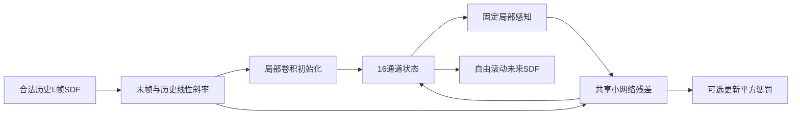

# 局部预测模型与可恢复训练

实现于 `morpholab_ml.models` 和 `morpholab_ml.training`，与HTTP、数据库和界面分离；依赖为可选CPU/CUDA extra。正式配置见 [ADR-0002](../project/decisions/ADR-0002-local-models-and-training-budget.md)。

图为本项目实际实现的计算关系，不代表生物细胞机制。NCA单元是网格计算状态。输入为经QC的历史派生轮廓形态，不是未来显微图像，也不提供真实干预因果效应。

## 模型合同

`build_model(kind, model_config)`严格检查五个模型键。`forward(history[B,L,Y,X], horizon)`只接受L≥2的有限[-1,1]浮点历史，返回fp32预测`[B,H,Y,X]`及实际状态更新平方惩罚；没有未来真值参数或teacher forcing。

NCA默认16状态、64宽度更新网络、identity/Sobel-x/y/Laplacian分组感知和复制边界；ConvGRU采用相同两通道摘要与16隐藏通道。Vanilla和regularized NCA同构同参数，差异仅为损失权重。默认可训练参数NCA 14,622、ConvGRU 18,417，计算量不严格等同。

## 训练与检查点

训练只打开train/validation NPZ。按源序列均匀采样，再选合法连续窗口；相同seed使用独立同流RNG，增强同时作用于历史和未来。自由滚动H12共同监督损失；每100步固定H24 validation，先窗口后序列等权选择best，共600步预算。

使用fp32并显式设置矩阵/卷积IEEE精度，关闭TF32近似；开启deterministic algorithms及固定seed，记录实际框架/设备/线程配置。这不是跨硬件浮点逐bit一致的承诺。

每次保存last与validation选定的best，包含模型、优化器、采样器与torch RNG、完整配置、源hash、Git SHA、run ID和原始开始时间。`weights_only=True`加载，不回退到任意pickle；可额外校验文件SHA256。resume严格比较数据/源码/关键配置，恢复参数与RNG，保留原运行开始时间。零步smoke可恢复；未到首次validation的短smoke没有best，不等于正式训练完成。

## 已验证到哪一级

- CPU合成数值fixture覆盖41项模型检查、7项训练/恢复检查；三模型的分段恢复与不间断参数逐tensor相同。
- 本机CUDA 12.8、Torch2.11已实际执行三模型各3步、batch8/H12的合成前向/反向/优化更新，显式IEEE fp32与deterministic模式下shape、有限loss和参数通过；GPU架构支持已实测。
- 上述均不是实际数据训练成绩。正式run须在源码提交、立即push并核对后从干净工作树启动，完整记录验证集选模；未完成前仍写未训练。
