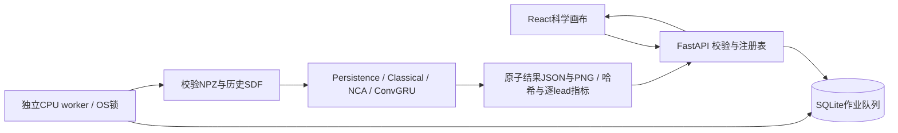

# 持久化预测作业

API只校验请求、固定数据/模型身份并入队。SQLAlchemy管理本地SQLite，独立worker获取OS排他锁后原子认领任务，
执行CPU形态推理并原子保存结果。模型核心不依赖HTTP、队列或数据库。默认只监听127.0.0.1。

`scripts/serve.py`启动API并管理单独worker进程；`--no-worker`可用于独立启动`scripts/worker.py`或诊断队列。
经典方法不需要Torch，神经模型需要cpu或cuda extra；worker仍以单线程CPU执行，IEEE fp32、确定性算法。
网页不触发训练。`frontend/dist`存在时提供生产静态文件与SPA深链接回退，API和缺失静态资源不回退成HTML。

状态为queued→running→succeeded/failed/cancelled。queued可立即取消，running取消在推理和逐帧转换边界检查；
终态写入使用数据库当前cancel标记，防止完成覆盖取消。短作业可能在用户点击前已完成，取消不承诺硬中断。
worker重启后，锁保证原worker已退出；未取消running重新排队，已请求取消的进入cancelled。
运行状态由5秒TTL心跳报告，不能把API HTTP200当作worker可用。

## 心跳、进程监管与恢复边界

Windows上已复现心跳JSON原子替换被读锁短暂阻止的 `WinError 5`。写入使用最多6次替换尝试及有界短退避；临时文件清理失败不覆盖原异常。心跳写入失败会限频记录警告并继续处理持久化队列，不会因此杀死worker。心跳过期表示就绪证据不足，不能据此认定进程已经退出。

`serve.py`的Supervisor只在 `poll()` 确认其自有child已经退出后，等待1秒再重启；滚动60秒内最多重启3次，达到限额或进程启动失败后停止自动重试并明确记录错误。Windows虚拟环境下直接启动真实解释器，保留虚拟环境身份并隐藏进程窗口，绕开venv redirector，确保监管的是实际执行进程。关停仅作用于该Supervisor拥有的child，先terminate并最多等待5秒，必要时kill并最多再等待3秒；监管线程的等待也有上限，不扫描或终止其他Python进程。

真实恢复验证已经完成：在作业处于running时终止Supervisor自有worker，随后同一job由自动重启的worker恢复为succeeded，24个lead的PNG资产可取得。这是实际进程与持久化作业验证，不是mock；它不表示最新完整6项E2E已经通过，该组检查仍待重跑。上述服务恢复不修改正式ML训练或评估结果。

每个神经variant从完整12-run矩阵按validation损失最小选seed（并列按seed），不读取test分数。
registry区分trained与available，校验best权重SHA256；提交时固定选中seed/hash和数据清单/NPZ hash。
worker再次验证数据并安全加载来源受控权重（weights_only=True）。损坏或替换不静默换模型。

新任务还固定实现身份：执行Git SHA、dirty状态、相关源码SHA256和环境。API与worker核对该身份，防止提交后源码变化却由不同实现继续执行；校验失败不能静默降级。结果 `implementation` 为可选字段，旧历史可为null，不能据此补造旧运行的环境信息。修改实现文件后需重启API与worker，不能仅依赖磁盘文件已更新。

请求只接受固定dataset、sequence/model白名单、起点非负、L∈{2,4,8}、H∈[1,24]，且全部范围在记录帧内。
历史QC必须全有效；未来标签无效时仍生成预测，但目标和指标为null。计算只把历史传入模型，未来仅在评价阶段读取。
结果contour为64工作网格中心坐标；展示viewBox=-0.5 -0.5 64 64，区域指标独立在离散64网格计算，不能混用128原图pixel。

结果JSON保留 `contours`、`region_area`、`target_area`、`metrics` 与 `images` URL/SHA256，不再返回 `region`/`target_region` 数组。预测、派生目标、FP/FN误差以64×64 PNG资产保存；`GET /api/v1/jobs/{id}/frames/{lead}?layer=prediction|target|error`读取相应图像并核验hash。没有有效未来目标时，目标面积、目标/误差资产和指标均为null；前端不从PNG重算科学指标。所有预测JSON统一 `MODEL_PREDICTION`，包括无需训练的经典基线；目标仍为 `DERIVED_ANNOTATION`，UI使用可读图例 `PREDICTION`。

数据与预测主链的响应由Pydantic模型约束，公开OpenAPI与生成的前端类型必须同步；生成、检查及各路由的准确契约见[API文档](api.md#类型契约与生成文件)。实验详情也可通过 `GET /api/v1/experiments/{id}`读取。Research图只由公开报告的文件名/hash白名单提供，不从任意服务器路径取图。

状态保存在忽略目录`artifacts/app`，来源缓存可通过进程环境`MORPHOLAB_ARTIFACTS_ROOT`只读指定。
前端没有任意服务器路径、pickle上传或命令执行入口；异常外发安全消息与trace_id，私有推理堆栈仅在worker本机日志。
本机单用户工具没有多租户认证、磁盘配额或分布式worker保证，不适合直接暴露公网。
