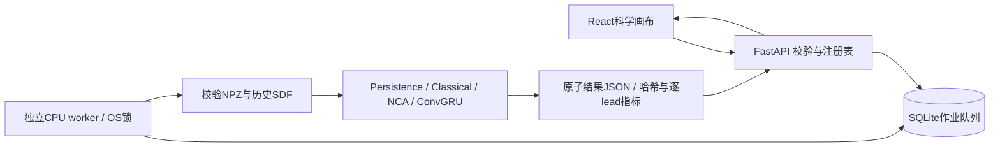

# 持久化预测作业

API只校验请求、固定数据/模型身份并入队。SQLAlchemy管理本地SQLite，独立worker获取OS排他锁后原子认领任务，
执行CPU形态推理并原子保存结果。模型核心不依赖HTTP、队列或数据库。默认只监听127.0.0.1。

`scripts/serve.py`启动API并管理单独worker进程；`--no-worker`可用于独立启动`scripts/worker.py`或诊断队列。
经典方法不需要Torch，神经模型需要cpu或cuda extra；worker仍以单线程CPU执行，IEEE fp32、确定性算法。
网页不触发训练。`frontend/dist`存在时提供生产静态文件与SPA深链接回退，API和缺失静态资源不回退成HTML。

状态为queued→running→succeeded/failed/cancelled。queued可立即取消，running取消在推理和逐帧转换边界检查；
终态写入使用数据库当前cancel标记，防止完成覆盖取消。短作业可能在用户点击前已完成，取消不承诺硬中断。
worker重启后，锁保证原worker已退出；未取消running重新排队，已请求取消的进入cancelled。
运行状态由5秒TTL心跳报告，不能把API HTTP200当作worker可用。

每个神经variant从完整12-run矩阵按validation损失最小选seed（并列按seed），不读取test分数。
registry区分trained与available，校验best权重SHA256；提交时固定选中seed/hash和数据清单/NPZ hash。
worker再次验证数据并安全加载来源受控权重（weights_only=True）。损坏或替换不静默换模型。

请求只接受固定dataset、sequence/model白名单、起点非负、L∈{2,4,8}、H∈[1,24]，且全部范围在记录帧内。
历史QC必须全有效；未来标签无效时仍生成预测，但目标和指标为null。计算只把历史传入模型，未来仅在评价阶段读取。
结果contour为64工作网格中心坐标；展示viewBox=-0.5 -0.5 64 64，区域指标独立在离散64网格计算，不能混用128原图pixel。

状态保存在忽略目录`artifacts/app`，来源缓存可通过进程环境`MORPHOLAB_ARTIFACTS_ROOT`只读指定。
前端没有任意服务器路径、pickle上传或命令执行入口；异常外发安全消息与trace_id，私有推理堆栈仅在worker本机日志。
本机单用户工具没有多租户认证、磁盘配额或分布式worker保证，不适合直接暴露公网。
