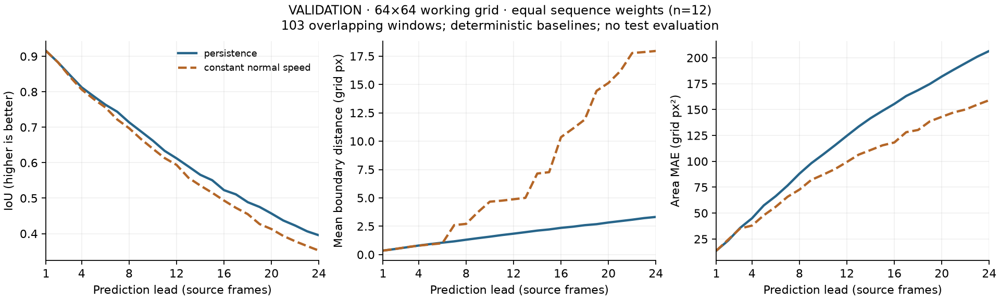
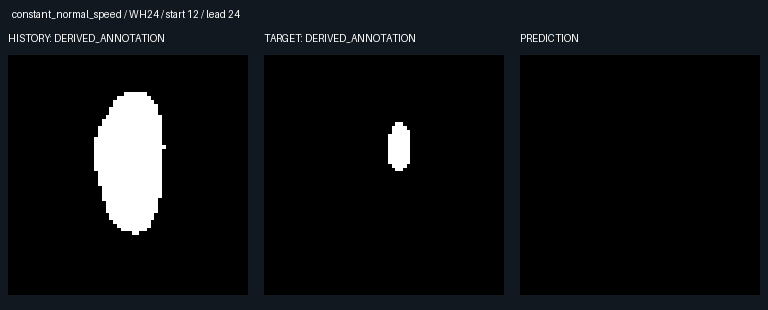

# 几何基线正式 validation 报告 v1

果蝇胚胎 in vivo 激光创面闭合；真实算法运行结果，非合成效果图。本报告仅包含确定性几何基线，不包含神经模型结果。

来源 Git：`bd3703294b679b9c140f18658e624162f3485e7e`；源运行 `git_dirty=false`、`status=complete`。
完整 62 序列源清单 SHA256：`a04b3a66c9fb910c6f3b180e5ce22ca185e721daeacda19433fde3f82fea6ce0`。
源清单完整性不代表评估了全部序列：本次仅 validation 的 12 序列、103 个有效窗口，QC 排除 4 个窗口。

采用项目新协议 `morpholab-split-v1`；官方实验级划分未知（null），不是对官方 test 成绩的复现。L=4，H=4/12/24，stride=12；所有 lead 共用最长 H 的有效窗口。先在各序列内平均窗口，再对 12 条序列等权；重叠窗口不是独立实验。两种基线均确定性，无训练、无三 seed 统计，图中无随机种子误差带，也未进行显著性检验。



曲线覆盖 lead 1–24。距离单位是 64×64 工作网格 pixel，面积单位是工作网格 pixel²；不能解释为微米或原始图像像素。目标是骨架化注释经填充与降采样得到的 DERIVED_ANNOTATION，不是原始人工区域真值。

| Baseline | Lead | IoU ↑ | Dice ↑ | Mean boundary distance ↓ | HD95 ↓ | Area MAE ↓ | Empty mismatch |
|---|---:|---:|---:|---:|---:|---:|---:|
| constant_normal_speed | 4 | 0.806421 | 0.888467 | 0.789265 | 1.716728 | 37.969511 | 0.000000 |
| constant_normal_speed | 12 | 0.593793 | 0.716050 | 4.879823 | 6.633419 | 99.379597 | 0.036343 |
| constant_normal_speed | 24 | 0.352109 | 0.465256 | 17.955533 | 20.343752 | 159.058234 | 0.171759 |
| persistence | 4 | 0.812514 | 0.893519 | 0.797450 | 1.798376 | 44.995205 | 0.000000 |
| persistence | 12 | 0.612303 | 0.747703 | 1.845216 | 3.978575 | 124.680390 | 0.000000 |
| persistence | 24 | 0.395312 | 0.540609 | 3.320710 | 6.791730 | 206.579597 | 0.000000 |

恒速基线在全部 24 个 lead 的序列等权 IoU 均未超过 persistence；面积 MAE 在三个正式 endpoint（4/12/24）均更低。完整曲线中 lead 1 持平、lead 2 略高，其余 22 个 lead 更低。面积接近并不保证形状与位置重叠更好，不能据此宣称恒速总体优越。本次不调参追分，也不据此宣称论文新颖性或 NCA 有效性。

边界采用内数字边界的双向最近距离。两侧均空时 IoU/Dice=1、距离=0；仅一侧为空时 IoU/Dice=0，距离赋 64×64 网格对角线惩罚 sqrt(64²+64²)=90.509668 pixel。该有限失败惩罚保留在均值内，解释了恒速长期边界误差的明显增加；Empty mismatch 是先序列内后序列间平均的比例，不能乘 103 当作原始失败窗口数。



WH24，window_start=12，lead=24，原始目标帧索引 39。左为最后历史派生区域，中为未来 DERIVED_ANNOTATION，右为 PREDICTION；恒速已预测为空，而目标仍有 65 工作像素²。该窗口 IoU=0、边界距离=90.509668 pixel。图直接复制源运行的实际算法产物，未重新生成预测。

源数据：Backova 等（2023），[Zenodo 7660424](https://doi.org/10.5281/zenodo.7660424)，[CC BY 4.0](https://creativecommons.org/licenses/by/4.0/)。修改包括注释填充、降采样、预测与面板展示；完整署名见 [datasets/ATTRIBUTION.md](../../datasets/ATTRIBUTION.md)。

公开机器摘要：[results/baselines-validation-v1.json](results/baselines-validation-v1.json)，保留源 Git、实现文件 hash、清单/压缩包 hash、实际依赖版本、运行配置、QC 和输入报告文件 hash。脚本从逐窗口指标重算两级均值并对照 summary 与失败 JSON，校验源 Git blob hash；不读取 test 数组、不覆盖源运行。

复现：先依数据准备文档取得相同 manifest，再从干净工作树执行（输出目录须不存在或为空）：

```powershell
uv run --locked python scripts/evaluate.py --output artifacts/experiments/baselines-validation-v1
uv run --locked --extra reports python scripts/report.py
```

正式报告拒绝 dirty、不完整或来源 hash 不匹配的运行。源运行依赖版本与报告绘图环境分开记录；曲线仅是本次 validation 的描述性结果，尚未验证 test、物理单位、独立外部数据或神经预测模型。
