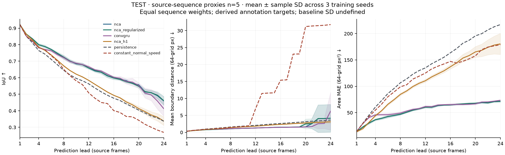
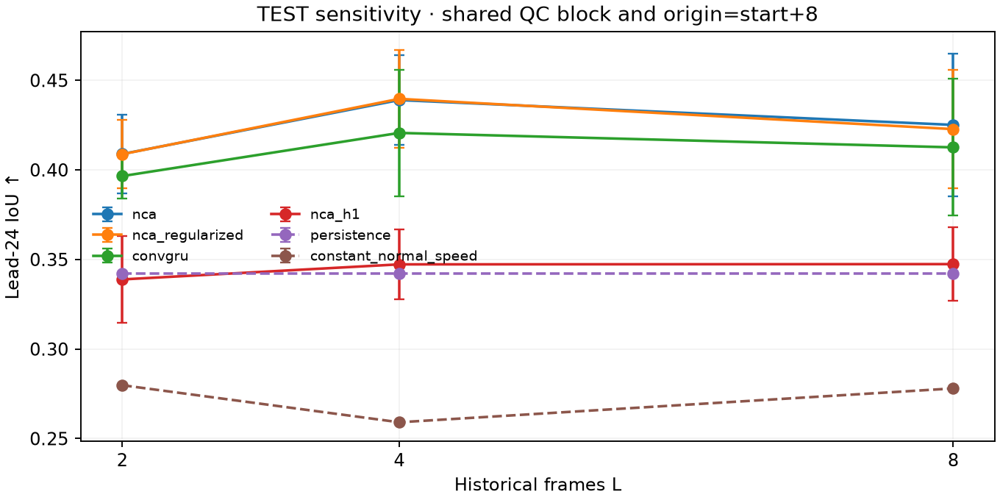
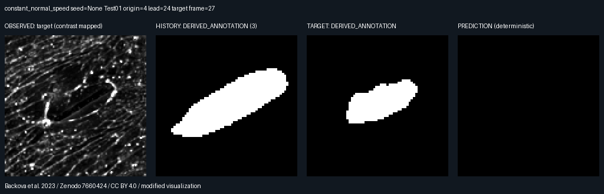
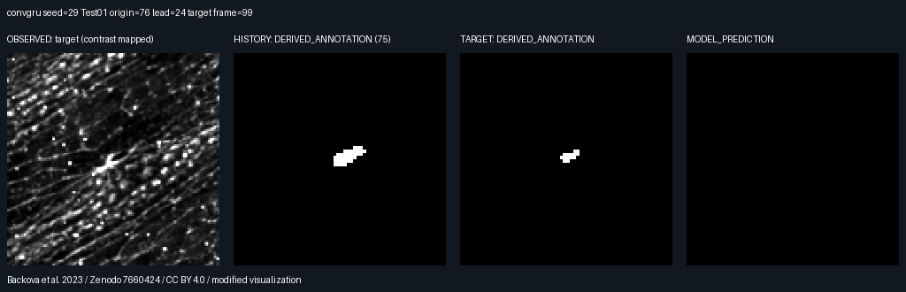
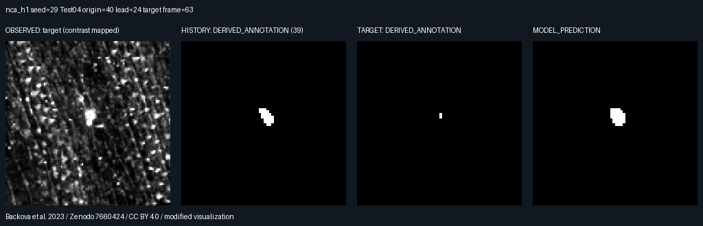
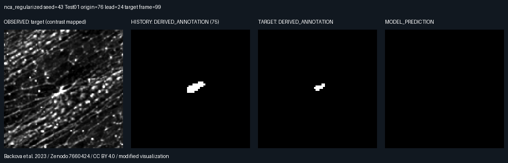
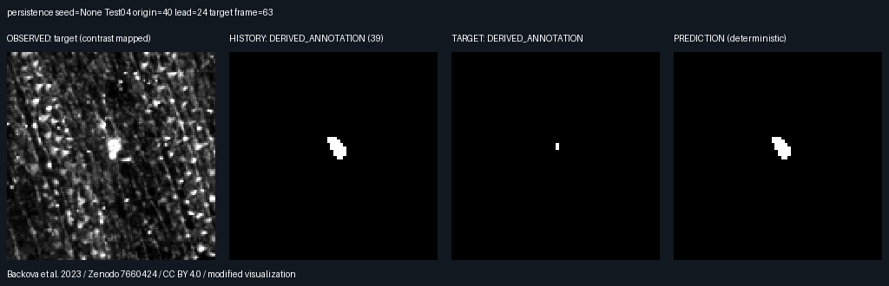

# 形态预测结果 v1 · test

果蝇胚胎 in vivo 激光创面闭合，历史轮廓条件下的派生形态预测。以下为真实运行结果，所有 seed 均保留，未按 test 成绩选择模型或调整参数。

评价 Git：`a83ed4d054b57ecd379804e6e163c51dd9fbe000`；`git_dirty=false`。数据清单 SHA256：`a04b3a66c9fb910c6f3b180e5ce22ca185e721daeacda19433fde3f82fea6ce0`。
有效源序列代理 n=5，每个方法/seed 主评价窗口=25。

采用 morpholab-split-v1；官方划分未知（null）。源序列仅作为生物独立性的代理分组；样本数少，同动物/批次关系未知，不能把序列×seed当作独立生物实验。任务不包含原始灰度图自动分割或未来显微纹理生成，目标 DERIVED_ANNOTATION 由原始薄轮廓填充、QC、降采样得到，不能冒称原始人工区域真值。

主评价 L4/H24/stride12，所有方法使用相同最长 H24 连续有效窗口。先序列内平均窗口，再序列等权得到每 seed 分数，最后对 seed17/29/43 求均值与样本标准差（ddof=1）。SD仅描述训练随机种子变化，不是生物学置信区间；未作显著性检验。重叠窗口不能作为独立实验。确定性基线仅计算一次，n_seeds=0、n_realizations=1，SD=null。

| Variant | Lead | n sequences | IoU ↑ | Dice ↑ | Mean boundary distance ↓ | HD95 ↓ | Area MAE ↓ | Empty mismatch |
|---|---:|---:|---|---|---|---|---|---|
| constant_normal_speed | 4 | 5 | 0.7819 (det.) | 0.8722 (det.) | 0.8790 (det.) | 1.9647 (det.) | 54.7357 (det.) | 0.0000 (det.) |
| constant_normal_speed | 12 | 5 | 0.5082 (det.) | 0.6296 (det.) | 6.9723 (det.) | 8.6912 (det.) | 125.0543 (det.) | 0.0571 (det.) |
| constant_normal_speed | 24 | 5 | 0.2691 (det.) | 0.3572 (det.) | 31.7822 (det.) | 33.9017 (det.) | 179.0686 (det.) | 0.3229 (det.) |
| convgru | 4 | 5 | 0.7808 ± 0.0017 | 0.8715 ± 0.0008 | 0.8606 ± 0.0077 | 1.9797 ± 0.0260 | 45.7319 ± 2.3436 | 0.0000 ± 0.0000 |
| convgru | 12 | 5 | 0.6665 ± 0.0086 | 0.7918 ± 0.0072 | 1.2773 ± 0.0306 | 2.8893 ± 0.0372 | 61.6038 ± 2.0087 | 0.0000 ± 0.0000 |
| convgru | 24 | 5 | 0.4128 ± 0.0446 | 0.5467 ± 0.0549 | 6.2423 ± 5.5621 | 8.3853 ± 5.4777 | 73.5471 ± 0.3114 | 0.0490 ± 0.0619 |
| nca | 4 | 5 | 0.7994 ± 0.0061 | 0.8836 ± 0.0041 | 0.7671 ± 0.0201 | 1.7613 ± 0.0604 | 36.4981 ± 1.5034 | 0.0000 ± 0.0000 |
| nca | 12 | 5 | 0.6587 ± 0.0067 | 0.7858 ± 0.0051 | 1.2875 ± 0.0303 | 2.9771 ± 0.1180 | 60.6467 ± 1.5657 | 0.0000 ± 0.0000 |
| nca | 24 | 5 | 0.4596 ± 0.0269 | 0.5959 ± 0.0390 | 4.1517 ± 4.0893 | 6.5359 ± 3.9212 | 71.2776 ± 1.1363 | 0.0262 ± 0.0454 |
| nca_h1 | 4 | 5 | 0.7857 ± 0.0021 | 0.8743 ± 0.0013 | 0.8283 ± 0.0129 | 1.9283 ± 0.0389 | 44.0567 ± 1.5152 | 0.0000 ± 0.0000 |
| nca_h1 | 12 | 5 | 0.5839 ± 0.0022 | 0.7226 ± 0.0019 | 1.8210 ± 0.0206 | 3.9176 ± 0.0209 | 110.5233 ± 2.7722 | 0.0000 ± 0.0000 |
| nca_h1 | 24 | 5 | 0.3377 ± 0.0264 | 0.4770 ± 0.0272 | 3.1057 ± 0.3929 | 6.8130 ± 0.2359 | 180.4643 ± 19.9833 | 0.0000 ± 0.0000 |
| nca_regularized | 4 | 5 | 0.7996 ± 0.0076 | 0.8838 ± 0.0051 | 0.7666 ± 0.0260 | 1.7597 ± 0.0722 | 36.5452 ± 1.5705 | 0.0000 ± 0.0000 |
| nca_regularized | 12 | 5 | 0.6591 ± 0.0069 | 0.7859 ± 0.0049 | 1.2785 ± 0.0356 | 2.9438 ± 0.1090 | 60.3300 ± 1.5458 | 0.0000 ± 0.0000 |
| nca_regularized | 24 | 5 | 0.4612 ± 0.0255 | 0.5974 ± 0.0355 | 4.1529 ± 4.0561 | 6.5506 ± 3.8787 | 71.3671 ± 1.4978 | 0.0262 ± 0.0454 |
| persistence | 4 | 5 | 0.7645 (det.) | 0.8608 (det.) | 0.9564 (det.) | 2.0957 (det.) | 60.5071 (det.) | 0.0000 (det.) |
| persistence | 12 | 5 | 0.5629 (det.) | 0.7058 (det.) | 2.0490 (det.) | 4.1483 (det.) | 134.9357 (det.) | 0.0000 (det.) |
| persistence | 24 | 5 | 0.3368 (det.) | 0.4761 (det.) | 3.6235 (det.) | 7.1021 (det.) | 217.1486 (det.) | 0.0000 (det.) |

距离单位为64×64工作网格pixel，面积为pixel²；物理标尺与逐帧实际时间未知。仅一侧边界为空时，IoU/Dice=0，边界距离保留网格对角线90.509668的有限惩罚；两侧均为空时IoU/Dice=1、距离=0。Empty mismatch也是序列等权后再跨seed统计的比例，不能直接乘窗口总数解释为失败次数。

下列差值直接从主表均值得到（前者减后者）；正负方向随指标而异，不作显著性或总体优越结论，不通过挑seed改变符号。

| Comparison | Lead | ΔIoU ↑ | ΔArea MAE ↓ | ΔMean boundary distance ↓ |
|---|---:|---:|---:|---:|
| nca − persistence | 4 | +0.034878 | -24.009048 | -0.189308 |
| nca − persistence | 12 | +0.095747 | -74.289048 | -0.761482 |
| nca − persistence | 24 | +0.122782 | -145.870952 | +0.528129 |
| nca − convgru | 4 | +0.018589 | -9.233810 | -0.093487 |
| nca − convgru | 12 | -0.007848 | -0.957143 | +0.010169 |
| nca − convgru | 24 | +0.046772 | -2.269524 | -2.090641 |
| nca_regularized − nca | 4 | +0.000220 | +0.047143 | -0.000554 |
| nca_regularized − nca | 12 | +0.000417 | -0.316667 | -0.009002 |
| nca_regularized − nca | 24 | +0.001581 | +0.089524 | +0.001261 |
| nca_h1 − nca | 4 | -0.013721 | +7.558571 | +0.061188 |
| nca_h1 − nca | 12 | -0.074813 | +49.876667 | +0.533484 |
| nca_h1 − nca | 24 | -0.121937 | +109.186667 | -1.045959 |

NCA正则消融只改变更新平方惩罚权重0→0.001；H1消融保持同NCA、samplingH12，仅监督前缀H1。H1与H12的600步预算相同，但实际计算量与训练用时不相等，不能据此主张严格等算力下的因果收益。以下所有数值均按实际结果呈现，不预设正则或多步监督有效。

| Variant | Seed | Parameters | Best validation step | Actual training seconds | CUDA peak allocated bytes | Model Git | Best SHA256 |
|---|---:|---:|---:|---:|---:|---|---|
| convgru | 17 | 18417 | 600 | 91.625 | 313368064 | `056332d083de1527e49342772ecf2ef974813959` | `ac958e0ed0e58d60f44647e969dff060c203c82238c9e443c6353021630b4c12` |
| convgru | 29 | 18417 | 500 | 89.953 | 313368064 | `056332d083de1527e49342772ecf2ef974813959` | `d89058da010ab3ecd7894fc1305797625a00e85cd215ae1eae3bf4084a974dab` |
| convgru | 43 | 18417 | 600 | 89.563 | 313368064 | `056332d083de1527e49342772ecf2ef974813959` | `1c2b7c36daaaf5379ed96a77b35263dc1faaa4aab2914df83fd4342d337b4657` |
| nca_h1 | 17 | 14622 | 200 | 30.157 | 63589888 | `056332d083de1527e49342772ecf2ef974813959` | `bf156c432492b229995599cf8b65441f2ee0fddc730cf9679f25851ac328b15d` |
| nca_h1 | 29 | 14622 | 500 | 30.125 | 63589888 | `056332d083de1527e49342772ecf2ef974813959` | `5ab2aa5f69df8705c46e9927da9cd0e570899092474d85227e7cd1203dfaa7a8` |
| nca_h1 | 43 | 14622 | 600 | 29.984 | 63589888 | `056332d083de1527e49342772ecf2ef974813959` | `8eaae04d90d04660c0368d9828af2e6f0ab1016a5577511396a4d237a4772c72` |
| nca_regularized | 17 | 14622 | 600 | 50.109 | 345181696 | `056332d083de1527e49342772ecf2ef974813959` | `b60cdb93bb5debd26d94da67fc5362ddccfc0869db3bf72e90b562f8427d6ef8` |
| nca_regularized | 29 | 14622 | 500 | 50.312 | 345181696 | `056332d083de1527e49342772ecf2ef974813959` | `2590d92f4eddc7caaaa4c4a26d71ba6a8c8cbe0c292d8e6fbc495caeb3eacd9d` |
| nca_regularized | 43 | 14622 | 400 | 51.109 | 345181696 | `056332d083de1527e49342772ecf2ef974813959` | `e9e686cc7c56f98d7166290f6e31b33ea856be9debe9b02dc1ab1cc18c1d9eda` |
| nca | 17 | 14622 | 600 | 65.469 | 373165056 | `056332d083de1527e49342772ecf2ef974813959` | `87af492952c5bac440f8a2c3f5d75e23f1b86ec345e93a8b7fe6cdb5d98c9ac7` |
| nca | 29 | 14622 | 500 | 48.969 | 373564416 | `056332d083de1527e49342772ecf2ef974813959` | `5b2c023345b3e1806f9eaf624acd60e2e92bb77f29fed69be1a8d7758afaf2cd` |
| nca | 43 | 14622 | 400 | 49.047 | 373564416 | `056332d083de1527e49342772ecf2ef974813959` | `e73f6bfbc5114ea46e3f8c9fd3b53785d19d4dc8c643c51998925ec4f3d4f3e0` |

显存为PyTorch实际峰值allocated，非整机总内存或FLOPs；CPU峰值内存未测则为null。每100步用validation多步监督损失选best，test不参与选模。

L2/4/8敏感性采用共同8帧候选块，forecast origin固定为start+8；每个L取该块末L帧，未来目标与QC窗口严格相同。它与主评价L4的起点协议不同，不能把敏感性L4直接当作主表L4重复实验。

失败案例按所有seed、所有主评价窗口中的最小lead24 IoU自动选取；没有挑好seed。面板包括真实未来显微影像OBSERVED（仅显示时映射对比度）、历史/未来DERIVED_ANNOTATION与MODEL_PREDICTION。确定性方法的面板标PREDICTION。

constant_normal_speed seed=None，Test01，origin=4，源目标帧=27，IoU=0.000000；empty_boundary_mismatch=True。

convgru seed=29，Test01，origin=76，源目标帧=99，IoU=0.000000；empty_boundary_mismatch=True。

nca seed=43，Test01，origin=76，源目标帧=99，IoU=0.000000；empty_boundary_mismatch=True。

nca_h1 seed=29，Test04，origin=40，源目标帧=63，IoU=0.058824；empty_boundary_mismatch=False。

nca_regularized seed=43，Test01，origin=76，源目标帧=99，IoU=0.000000；empty_boundary_mismatch=True。

persistence seed=None，Test04，origin=40，源目标帧=63，IoU=0.076923；empty_boundary_mismatch=False。

源数据：Backova等（2023），[Zenodo 7660424](https://doi.org/10.5281/zenodo.7660424)，[CC BY 4.0](https://creativecommons.org/licenses/by/4.0/)。修改包括区域派生、降采样、预测和可视化；完整署名见[ATTRIBUTION](../../datasets/ATTRIBUTION.md)。

本报告不声称原作者官方split复现、临床适用、真实干预因果效应或论文新颖性。是否支持NCA、正则与多步监督，应结合完整负结果、失败案例、少量序列与预算限制判断。
